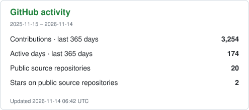
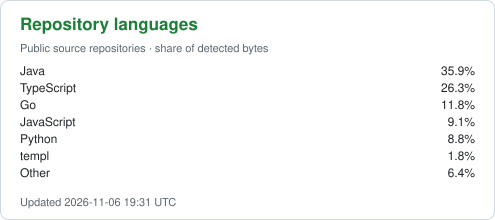
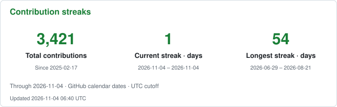

# Jaden Razo

I build apps, developer tools, and cloud infrastructure. I'm also the founder of
[RaizHost](https://raizhost.com), where I build and host websites for local businesses.

Some projects refuse to stay weekend projects.

## What I'm working on

Three projects I'm especially enjoying right now:

- **RaizHost Business OS** — a platform in development for service businesses, starting
  with bookings, scheduling, and the workflows around them.
- **[RaizHost website editor](https://app.raizhost.com)** — helping business owners update
  their content, preview changes, and publish their websites.
  [How the editor works](https://github.com/JadenRazo/raizhost-architecture/blob/main/docs/app-raizhost-com.md).
- **[LLM Tracker](https://llm.raizhost.com)** — bringing model comparisons, provider releases,
  and practical references for Claude, OpenAI, and Gemini into one place.

## Selected projects

### LLM Tracker

Compare models, explore their strengths and tradeoffs, and follow provider releases and CLI
updates. Curated model profiles sit alongside feeds collected on a schedule.

[Code](https://github.com/JadenRazo/llm-tracker) · [Explore the site](https://llm.raizhost.com) · [How it runs](https://github.com/JadenRazo/raizhost-architecture/blob/main/docs/llm-raizhost-com.md)

### RaizHost architecture

A public tour of the websites, owner editor, and AWS platform behind RaizHost. Follow an
owner's edit through preview, GitHub, and deployment, with dated operating evidence and limits.

[Architecture](https://github.com/JadenRazo/raizhost-architecture) · [Editor walkthrough](https://github.com/JadenRazo/raizhost-architecture/blob/main/docs/owner-publishing.md) · [Operating evidence](https://github.com/JadenRazo/raizhost-architecture/blob/main/docs/current-state.md)

### llm-lint

A configurable CLI for repository policies around AI-assisted development. Reports findings
in SARIF and ships native Go binaries through npm, without postinstall scripts.

[Code](https://github.com/JadenRazo/llm-lint) · [Try it with npm](https://www.npmjs.com/package/@jadenrazo/llm-lint) · [Quick start](https://github.com/JadenRazo/llm-lint#quick-start)

### CloudCostMCP

Estimate costs from Terraform plans across AWS, Azure, and GCP. The pricing-drift write-up
follows a real defect through detection, fixes, live verification, and regression checks.

[Code](https://github.com/JadenRazo/CloudCostMCP) · [npm package](https://www.npmjs.com/package/@jadenrazo/cloudcost-mcp) · [Incident write-up](https://github.com/JadenRazo/CloudCostMCP/blob/main/docs/incidents/2026-08-pricing-drift.md)

### EKS Compute Operations Lab

An AWS/Kubernetes lab exploring EC2 and Fargate operations: four controlled failure exercises
and adoption of 23 existing resources into Terraform. Both clusters were removed after the exercises.

[Code and evidence](https://github.com/JadenRazo/eks-compute-operations-lab) · [Service recovery](https://github.com/JadenRazo/eks-compute-operations-lab/blob/main/docs/incidents/INC-002-service-selector-mismatch.md) · [Terraform adoption](https://github.com/JadenRazo/eks-compute-operations-lab/blob/main/docs/architecture/terraform-adoption.md)

### SRE Reference App

A controlled ECS task-stop exercise with a documented 78-second recovery, SLO burn-rate
alarms, and a runbook. The write-up explains the lab conditions and measurement limits.

[Code](https://github.com/JadenRazo/sre-reference-app) · [Failure exercise](https://github.com/JadenRazo/sre-reference-app/blob/main/docs/chaos-experiments.md) · [Runbook](https://github.com/JadenRazo/sre-reference-app/blob/main/runbooks/high-latency.md)

## Live projects

- **[RaizHost](https://raizhost.com)** — websites and hosting for local businesses.
- **[Website editor](https://app.raizhost.com)** — the owner portal for RaizHost client sites; sign-in required.
- **[LLM Tracker](https://llm.raizhost.com)** — model comparisons, release feeds, and AI tooling references.
- **[My portfolio](https://jadenrazo.dev/)** — more about me and my projects.
- **[Showers Auto Detail](https://showersautodetail.com)** — a client website I maintain.

[Service status and incident history](https://status.raizhost.com)

## How I work

- Prefer Terraform, OIDC, least-privilege workflow permissions, and repeatable CI over stored
  deployment credentials or console-only changes.
- Treat cost, rollback, security, and operational ownership as design inputs, not cleanup after
  launch.
- Define the reliability target, instrument it, inject a controlled failure, and keep the
  measurement and corrective action beside the code.
- Publish limitations and failed hypotheses so architecture intent is never mistaken for measured
  evidence.

## Tech stack

A few of the technologies behind the projects above:

<picture>
  <source media="(prefers-color-scheme: dark)" srcset="https://skillicons.dev/icons?i=go%2Cts%2Cpy%2Caws%2Cterraform%2Cdocker%2Ckubernetes%2Cgithubactions%2Cpostgres%2Cnextjs%2Creact%2Clinux&amp;perline=6&amp;theme=dark">
  <source media="(prefers-color-scheme: light)" srcset="https://skillicons.dev/icons?i=go%2Cts%2Cpy%2Caws%2Cterraform%2Cdocker%2Ckubernetes%2Cgithubactions%2Cpostgres%2Cnextjs%2Creact%2Clinux&amp;perline=6&amp;theme=light">
  
</picture>

<strong>More technologies and tools</strong>

<strong>Languages</strong>

<picture>
  <source media="(prefers-color-scheme: dark)" srcset="https://skillicons.dev/icons?i=go%2Cpy%2Cts%2Cjava%2Cjs%2Cbash%2Cpowershell%2Chtml%2Ccss%2Cswift%2Clua%2Cmd&theme=dark&perline=6">
  <source media="(prefers-color-scheme: light)" srcset="https://skillicons.dev/icons?i=go%2Cpy%2Cts%2Cjava%2Cjs%2Cbash%2Cpowershell%2Chtml%2Ccss%2Cswift%2Clua%2Cmd&theme=light&perline=6">
  
</picture>

<strong>Cloud & infrastructure</strong>

<picture>
  <source media="(prefers-color-scheme: dark)" srcset="https://skillicons.dev/icons?i=aws%2Cterraform%2Cdocker%2Ckubernetes%2Cgithubactions%2Clinux%2Cazure%2Cgcp%2Ccloudflare&theme=dark&perline=6">
  <source media="(prefers-color-scheme: light)" srcset="https://skillicons.dev/icons?i=aws%2Cterraform%2Cdocker%2Ckubernetes%2Cgithubactions%2Clinux%2Cazure%2Cgcp%2Ccloudflare&theme=light&perline=6">
  
</picture>

<strong>Data & web</strong>

<picture>
  <source media="(prefers-color-scheme: dark)" srcset="https://skillicons.dev/icons?i=postgres%2Credis%2Csqlite%2Cdynamodb%2Creact%2Cnextjs%2Cnodejs%2Castro%2Cvue%2Cexpress%2Cvite%2Ctailwind&theme=dark&perline=6">
  <source media="(prefers-color-scheme: light)" srcset="https://skillicons.dev/icons?i=postgres%2Credis%2Csqlite%2Cdynamodb%2Creact%2Cnextjs%2Cnodejs%2Castro%2Cvue%2Cexpress%2Cvite%2Ctailwind&theme=light&perline=6">
  
</picture>

<strong>Tooling</strong>

 

<strong>Full project directory</strong>: cloud &amp; SRE, tooling, web, game servers

 

<strong>Cloud &amp; SRE</strong>

| Repository | Description |
| :-- | :-- |
| [sre-landing-zone](https://github.com/JadenRazo/sre-landing-zone) | AWS landing-zone lab modeling five accounts, Pilot Light DR, CloudFront/WAF/Cognito edge controls, and cross-account auto-stop. |
| [ssm-access-workbench](https://github.com/JadenRazo/ssm-access-workbench) | PowerShell toolkit for MobaXterm SSH/SFTP to Linux EC2 through IAM Identity Center and Session Manager, with scoped IAM policies and console runbooks. |
| [aws-supply-chain-security](https://github.com/JadenRazo/aws-supply-chain-security) | Container supply-chain stack with syft SBOMs, grype scans, and keyless cosign signing through GitHub OIDC. |
| [zeroday-release-verifier](https://github.com/JadenRazo/zeroday-release-verifier) | Verifies public release files and patch notes against supplied SHA-256 hashes; a delivery check, not a build or signing system. |
| [azure-hub-spoke-network](https://github.com/JadenRazo/azure-hub-spoke-network) | Archived Azure hub-and-spoke Terraform lab retained as a code-study reference, not represented as a live environment. |
| [initializing-ad](https://github.com/JadenRazo/initializing-ad) | Archived Active Directory homelab documenting AD DS, DNS, user provisioning, domain join, and file sharing. |

<strong>Web & apps</strong>

| Repository | Description |
| :-- | :-- |
| [Project-Website](https://github.com/JadenRazo/Project-Website) | The Go-powered portfolio behind [jadenrazo.dev](https://jadenrazo.dev/), including a URL shortener, messaging, and project pages. |
| [TicketHacker](https://github.com/JadenRazo/TicketHacker) | Helpdesk platform unifying Discord, Telegram, email, and live chat into one ticketing system. |
| [tts-raizhost](https://github.com/JadenRazo/tts-raizhost) | Self-hosted PDF reader-aloud using Kokoro TTS, Next.js, k3s, and GPU/CPU backends with circuit-breaker fallback. |
| [EzWeb](https://github.com/JadenRazo/EzWeb) | Archived earlier Go-based Docker site manager for deploying and monitoring containerized websites. |

<strong>Game servers & bots</strong>

| Repository | Description |
| :-- | :-- |
| [ServerPlugins](https://github.com/JadenRazo/ServerPlugins) | Archived suite of 24 interconnected Paper plugins covering claims, economy, events, administration, backpacks, arcade games, and parkour. |
| [SurvivalCore](https://github.com/JadenRazo/SurvivalCore) | Archived experimental Paper patch set: an unsupported code-study reference with no claimed verified build or benchmarks. |
| [Quiz-Bot](https://github.com/JadenRazo/Quiz-Bot) | Archived Discord bot that turns LLM-generated questions into educational quiz games. |

## Get in touch

For questions, ideas, or collaboration, [email me](mailto:contact@jadenrazo.dev) or
[connect on LinkedIn](https://linkedin.com/in/JadenRazo).
I'm also open to full-time cloud/DevOps roles and SRE or platform teams.

## Activity

<strong>Activity and stats</strong>: contributions, languages, streaks, and repository line counts

<!-- STATS_START -->
*Last successful refresh: **2026-11-11 06:44:04 UTC**. Scheduled every six hours.*

**3,434 contributions since 2025-02-17** · **1 day current streak** · **54 day longest streak**

<picture>
  <source media="(prefers-color-scheme: dark)" srcset="https://raw.githubusercontent.com/JadenRazo/JadenRazo/main/generated/stats-dark.svg?v=e7296bad360d30fb">
  <source media="(prefers-color-scheme: light)" srcset="https://raw.githubusercontent.com/JadenRazo/JadenRazo/main/generated/stats-light.svg?v=3b4f8fab40d9e85b">
  
</picture>
<picture>
  <source media="(prefers-color-scheme: dark)" srcset="https://raw.githubusercontent.com/JadenRazo/JadenRazo/main/generated/top-langs-dark.svg?v=8fce9b86c2684108">
  <source media="(prefers-color-scheme: light)" srcset="https://raw.githubusercontent.com/JadenRazo/JadenRazo/main/generated/top-langs-light.svg?v=f7d17e2d25f7203e">
  
</picture>
<picture>
  <source media="(prefers-color-scheme: dark)" srcset="https://raw.githubusercontent.com/JadenRazo/JadenRazo/main/generated/streak-dark.svg?v=9192122b8fa50659">
  <source media="(prefers-color-scheme: light)" srcset="https://raw.githubusercontent.com/JadenRazo/JadenRazo/main/generated/streak-light.svg?v=c48fb5895229c96a">
  
</picture>

Counts follow GitHub’s contribution calendar; private contributions follow profile visibility.
Streaks use GitHub calendar dates and a UTC cutoff, with today allowed to be unfinished. Language shares measure
repository bytes, not authored lines or proficiency; forks are excluded and archived sources are included.
[Live contribution calendar](https://github.com/JadenRazo?tab=overview) · [Data and definitions](.github/STATS.md)
<!-- STATS_END -->

### Repository line counts

<!-- LOC_START -->
**1,849,088** lines of code across **2,113,400** total lines in **42** repositories

| Language | Lines of Code | Share |
| :-- | --: | --: |
| JSON | 729,621 | 39.5% |
| Java | 278,735 | 15.1% |
| TypeScript | 229,536 | 12.4% |
| Go | 124,504 | 6.7% |
| Markdown | 90,462 | 4.9% |
| HTML | 84,782 | 4.6% |
| YAML | 40,604 | 2.2% |
| Python | 39,074 | 2.1% |
| JavaScript | 36,624 | 2.0% |
| Luau | 36,115 | 2.0% |
| CSV | 21,044 | 1.1% |
| Astro | 20,157 | 1.1% |

*Last successful scan: 2026-11-10T15:13:44Z.*
<!-- LOC_UPDATED: 2026-11-10T15:13:44Z -->
<!-- LOC_END -->

*Scheduled daily across non-fork source repositories, including archived projects and excluding this profile repository, via
[GitHub Actions](.github/workflows/loc-counter.yml). A failed or incomplete scan is never published.*
These counts inventory repository contents; they are not lines I personally authored or a measure of proficiency.

A snake eats my contribution graph, counting contributions as it goes. It starts with four
segments, grows every eight occupied cells up to twelve, and resets when the animation loops.
Its route is regenerated four times a day; updates can be delayed.

<picture>
  <source media="(prefers-color-scheme: dark)" srcset="https://raw.githubusercontent.com/JadenRazo/JadenRazo/output/github-snake-dark.svg">
  <source media="(prefers-color-scheme: light)" srcset="https://raw.githubusercontent.com/JadenRazo/JadenRazo/output/github-snake.svg">
  
</picture>
